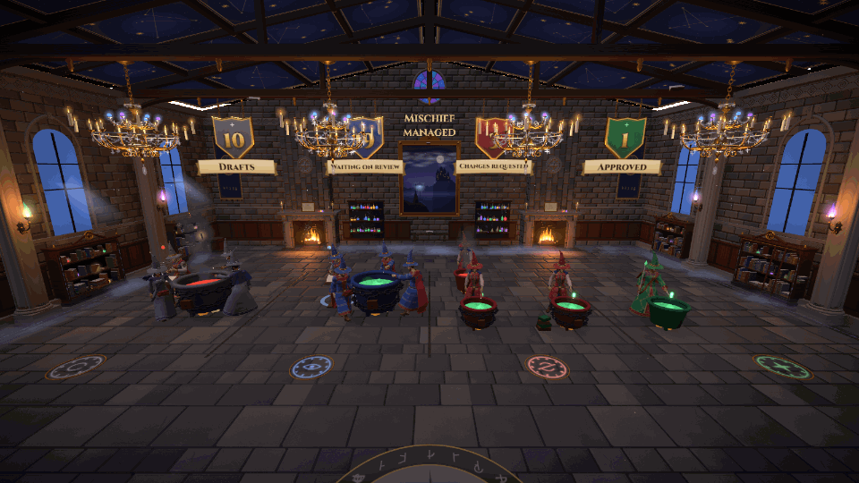

# PR Cauldron Hall

Your open pull requests, brewing in a wizard's hall.



PR Cauldron Hall turns the PRs you have open on GitHub into a small 3D game. Each PR is a wizard brewing at a cauldron, and each stage of review has its own corner of a candlelit castle hall. You walk the hall as your own wizard and see at a glance what is still a draft, what is waiting on reviewers, what needs changes and what is ready to merge.

## Why I made it

These days I end up with a lot of PRs open at once, and it is easy to lose track of which ones are approved, which still need changes, which are sitting in draft and which are blocked on a conflict or a failing check. GitHub's lists answer that, but only if you go and read them. I wanted something I could leave open that shows the state of all my work in one glance, makes the boring parts (CI failures, merge conflicts, stale branches) impossible to miss, and is a bit more fun to look at than a table.

## What it shows

The hall is split into four zones, one per stage, each with a banner naming it:

| Zone | Means |
|---|---|
| Drafts | PRs still marked as draft |
| Waiting on review | Open, not draft, no decision yet |
| Changes requested | A reviewer asked for changes |
| Approved | Approved and ready to merge |

Each wizard and cauldron carries more detail:

- **Brew colour:** CI state. Green for passing, purple and bubbling for running, red with smoke for failing.
- **Chains** around a cauldron: the PR has a merge conflict.
- **Stone:** the PR has gone stale (no activity for a while).
- **Leaving on a broom:** a PR that was just merged flies off; a closed one vanishes.
- **The Headmaster:** when a zone has more than four PRs, a Headmaster stands at a grand cauldron with students helping, and clicking him opens a ledger of every PR in that zone.

Click a wizard (or aim at it and press E) to open its card: CI checks, merge state, lines changed split into code and tests, branch, reviews, any PRs stacked on it, and a link to GitHub.

It refreshes from GitHub every minute, and the "Accio PRs" button refreshes immediately.

## Setting it up

You need Node 20 or newer, git and the [GitHub CLI](https://cli.github.com). PR Cauldron Hall reads GitHub through your own `gh` login, so it shows your PRs and only sees repositories your account can see.

1. Install the tools if you don't have them (macOS with Homebrew shown):

   ```bash
   brew install node gh
   ```

2. Sign in to GitHub once:

   ```bash
   gh auth login
   ```

3. Get the code and install it:

   ```bash
   git clone https://github.com/Sahil24680/pr-cauldron-hall.git
   ```

   ```bash
   cd pr-cauldron-hall && npm install
   ```

4. Start it, naming the repository whose PRs you want to see:

   ```bash
   PR_BOARD_REPO=your-org/your-repo npm run dev
   ```

5. Open the address it prints (Chrome works best) and click **Play**.

### Settings

| Variable | Default | What it does |
|---|---|---|
| `PR_BOARD_REPO` | required | Repository to watch, as `owner/name` |
| `PR_BOARD_SCOPE` | `mine` | `mine` for PRs you opened, `all` for every open PR in the repo |
| `PR_BOARD_INTERVAL_SECONDS` | `60` | How often to ask GitHub for updates |
| `PR_BOARD_PORT` | `4848` | Port of the small local API server |
| `PORT` | `5180` | Port of the web page |

`npm start` builds the page and serves everything from one Node process instead of the dev server.

## Playing

| Keys | Action |
|---|---|
| W A S D | Walk (the camera decides which way is forward) |
| W W (double tap, hold) | Sprint, on the ground or flying |
| Space | Jump |
| Space Space (double tap) | Take off on your broom; again to land |
| Space, Shift / Ctrl / C | Fly up and down |
| Mouse, scroll | Look around, zoom |
| Click or E | Read the PR you are aiming at |
| V or F5 | Switch between third and first person |
| Esc | Open the menu and get your mouse back |

In first person the mouse is captured so it can't leave the window; press Esc to get the cursor back. The full list is in the menu under Help.

## Your wizards

Open the menu (Esc or the gear) and choose **Appearance** to dress the cast in a Magic Mirror: yourself, the wizard for each zone, and the Headmaster. You can change body and build, hair, skin, beard, glasses, robe style and pattern, cape, accessories, wand and staff, and the mirror previews every change live.

The cast is saved to `shared/cast.json`, a plain file in the repo. Commit it if you want everyone who clones your copy to see the same characters; leave it uncommitted to keep your choices local.

## How it is built

- **Web page:** TypeScript, React, React Three Fiber and Three.js for the hall, with a few drei helpers and a small cloth simulation for capes.
- **Server:** a small Node server polls GitHub's GraphQL API through `gh`, keeps the last board on disk, and streams changes to the page.
- **Characters:** rigged human models with an animation library, dressed in robes generated from the body mesh so they move with every animation.

Useful commands:

```bash
npm run check
```

runs the type checker, Biome and the tests. Opening `/#inspect` shows the whole cast side by side, and adding `?motion=walk` (or `brew`, `sprint`, `ride` and so on) previews an animation.

## Credits

Characters, hairstyles, animations, boots and pauldrons are by [Quaternius](https://quaternius.com) (CC0); see `public/models/CREDITS.txt`. Fabric and leather detail maps are from [ambientCG](https://ambientcg.com) (CC0); see `public/textures/CREDITS.txt`.

## What's next

More features are on the way. Planned so far:

- **Claude at work:** show when a Claude Code session is currently iterating on one of your pushed PRs, so you can see at a glance which wizards have an AI apprentice brewing alongside them right now.
- **Sign in with GitHub** in the browser, so it can be hosted for others instead of run locally.
- **Several repositories** watched at once.
- **Review requests** waiting on you, alongside your own PRs.
